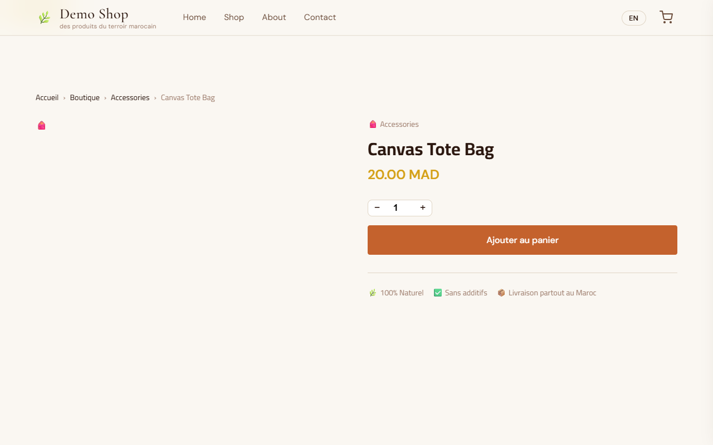
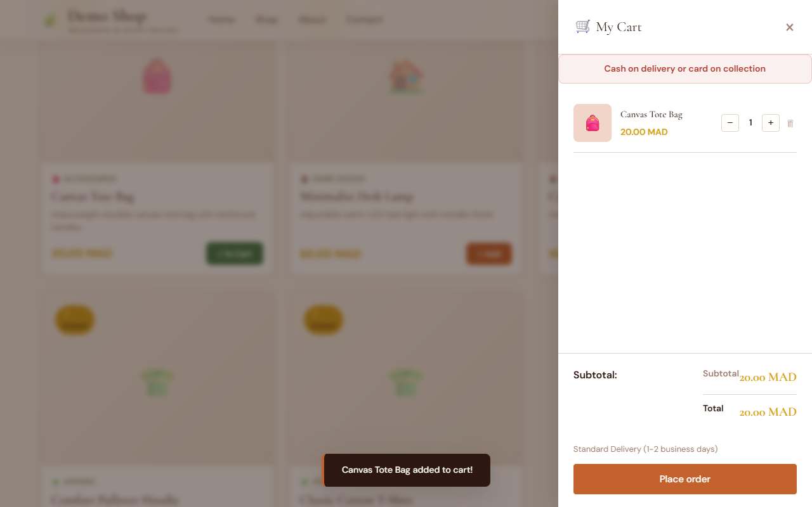
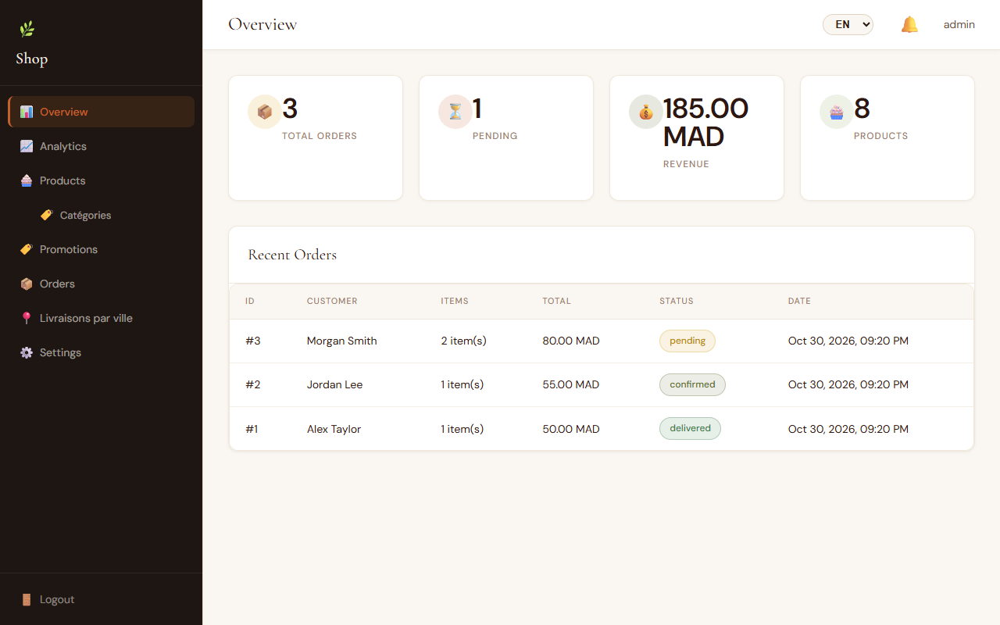
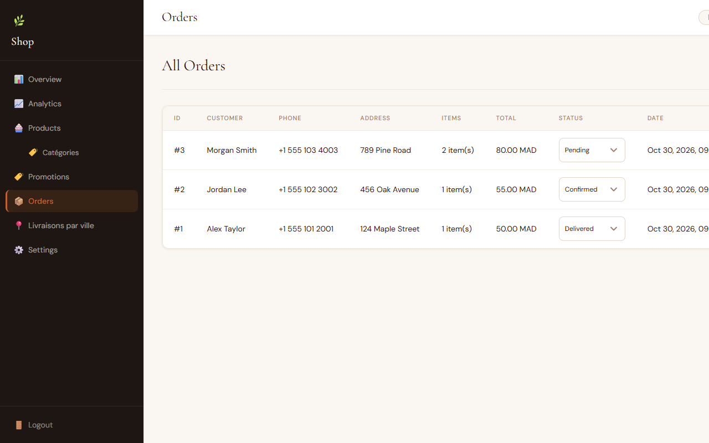

# Shop Ordering Platform

[](https://github.com/sabirkaddouri/business-ordering-platform/actions/workflows/ci.yml)

A full-stack ordering and e-commerce platform for small businesses, with an admin dashboard, multilingual support (French, English, Arabic with RTL), and WhatsApp order notifications.


## Features

- **Full product catalog** with categories, size variants, and stock management
- **Customer ordering system** with a Moroccan cities dropdown at checkout
- **Promo code system** with global and product-specific targeting
- **Admin panel** with an overview dashboard, product management, order management, and settings
- **City-based order sorting dashboard** for delivery logistics
- **Real-time admin notifications** for new orders
- **WhatsApp integration** for order confirmations and customer updates
- **Dynamic shop settings** connected live to the client-facing website
- **Analytics page** with revenue tracking and best-selling products
- **Store open/closed toggle** with a custom closed message
- **Multilingual Support** (French, English, Arabic with RTL layout)

## Tech Stack

- **Frontend:** HTML, CSS, Vanilla JavaScript
- **Backend:** Node.js, Express.js
- **Database:** PostgreSQL
- **Hosting:** Railway (planned)

## Getting Started

1. **Clone the repository:**
   ```bash
   git clone https://github.com/sabirkaddouri/business-ordering-platform.git
   ```

2. **Install dependencies:**
   ```bash
   npm install
   ```

3. **Copy the environment file:**
   ```bash
   cp .env.example .env
   ```

4. **Environment Variables:**
   Ensure your `.env` file contains the following variables:
   - `DATABASE_URL` (PostgreSQL connection string)
   - `JWT_SECRET` (Secret key for JWT authentication)
   - `ADMIN_USERNAME` (Default admin username)
   - `ADMIN_PASSWORD` (Default admin password)
   - `ALLOWED_ORIGINS` (Comma-separated list of allowed CORS origins)

5. **Start the development server:**
   ```bash
   npm run dev
   ```
   *or*
   ```bash
   npm start
   ```

6. **Open** `http://localhost:5000` in your browser.

## Admin Password Management

If you forget the admin password or need to rotate credentials, use the built-in CLI script:

### Interactive Mode (Local / Terminal)
```bash
npm run reset-admin-password
```
Displays existing admin accounts, asks which one to reset, prompts for the new password twice with hidden input, enforces minimum 12 characters, rejects common weak passwords, and requests confirmation before saving.

### Non-Interactive Mode (Railway / CI)
```bash
ADMIN_USERNAME="admin" NEW_ADMIN_PASSWORD="YourStrongPassword123!" npm run reset-admin-password
```

> [!NOTE]
> **Session Expiry Notice:** Resetting the password takes effect immediately for all new login attempts. Note that existing active JWT login sessions remain valid for up to 2 hours (the token lifespan) following a reset.

## Legal Setup per Shop

Each online shop operating in Morocco must comply with applicable commercial and data protection legislation (Law 31-08 for consumer protection and Law 09-08 for CNDP data protection).

All legal details are configured in `public/js/legal-config.js` and automatically populate three multi-language pages:
- **Mentions légales (`/legal.html`)**: Publisher identity (ICE, RC, legal form, capital, publication director), hosting provider, CNDP reference, and intellectual property.
- **Politique de confidentialité (`/privacy.html`)**: Data controller identity, data hosting (including cross-border server location notices), customer rights (access, rectification, opposition, deletion), and CNDP declaration reference. Note: the storefront uses **zero tracking cookies** and **no third-party analytics**; browser `localStorage` is used solely for the cart and language preference.
- **Conditions Générales de Vente (`/terms.html`)**: Prices (TTC/HT), delivery timeframes, payment on delivery, right of withdrawal (7-day legal minimum under Law 31-08, exclusions), and after-sales customer service.

> [!IMPORTANT]
> **Legal Disclaimer:** The included legal pages are standard templates and do not constitute legal advice. Each shop owner is responsible for their own legal compliance (CNDP prior declaration, cross-border transfer declaration if hosted abroad, and commercial registration). Have all pages reviewed by a qualified Moroccan business lawyer.
>
> 📄 **Complete Guide & Printable Checklist:** See [docs/SHOP-LEGAL-CHECKLIST.md](docs/SHOP-LEGAL-CHECKLIST.md) for full instructions on configuring each field and preparing your store for launch.

## Project Structure

- `/public` — client-facing HTML, CSS, and JavaScript files
- `/admin` — admin panel HTML, CSS, and JavaScript files
- `/routes` — Express API route handlers
- `/db` — database connection and schema
- `/middleware` — Express middleware (authentication, validation)
- `server.js` — main entry point

## Screenshots

| Storefront (Desktop) | Storefront (Mobile) |
| :---: | :---: |
|  |  |

| Product Details | Cart Drawer |
| :---: | :---: |
|  |  |

| Admin Dashboard | Admin Orders |
| :---: | :---: |
|  |  |


## Security

This application includes the following security hardening measures:

### HTTP Security
- **Helmet** security headers with a tailored Content-Security-Policy
- **HSTS** enabled in production with preload
- **X-Powered-By** header disabled
- **HTTP-to-HTTPS** redirect in production

### Rate Limiting & Brute Force Protection
- Login lockout: max 5 failed attempts per 15 minutes (per IP and per username)
- OTP endpoint: max 5 requests per IP per 15 minutes
- Order endpoint: max 10 requests per IP per 15 minutes
- General API rate limiter: 300 requests per 15 minutes per IP

### Input Validation
- All POST/PUT/PATCH bodies validated with **Zod** schemas (`.strict()` — unknown fields rejected)
- Route parameters validated as positive integers
- JSON body size limit: 100KB
- All SQL queries use parameterized placeholders

### Authentication
- JWT tokens pinned to HS256 algorithm with 2-hour expiry
- bcrypt cost factor 12
- Timing-safe login (dummy hash comparison for non-existent users)
- Production startup checks: JWT_SECRET ≥ 32 chars, ADMIN_PASSWORD ≥ 12 chars and not a known weak value

### File Uploads
- Restricted to JPEG, PNG, and WebP only (no GIF)
- Magic-byte / file-header validation (prevents extension spoofing)
- 5MB file size limit

### XSS Prevention
- All dynamic user content escaped with `escapeHtml()` in both storefront and admin

### CORS
- Production requires explicit `ALLOWED_ORIGINS` whitelist — no wildcard fallback

### Error Handling
- Central error handler hides stack traces and internal details in production
- OTP codes are never logged; only last 4 digits of phone are logged
- API 404 handler returns clean JSON error

### Required Production Environment Variables

| Variable | Description |
| --- | --- |
| `DATABASE_URL` | PostgreSQL connection string |
| `JWT_SECRET` | ≥ 32 character secret for JWT signing |
| `ADMIN_USERNAME` | Admin login username |
| `ADMIN_PASSWORD` | ≥ 12 character admin password (not a common weak value) |
| `ALLOWED_ORIGINS` | Comma-separated list of allowed CORS origins |
| `NODE_ENV` | Must be set to `production` on the host server to enable all production security checks (HSTS, CSP, JWT length, password strength, CORS restrictions, error masking) |

> [!IMPORTANT]
> **Production Deployment Notes:**
> - `NODE_ENV=production` **must be set on the host server** (e.g., Railway, Render, VPS) to activate strict security checks and protections.
> - `ENFORCE_OTP` **must stay `false`** until a real SMS provider (such as Twilio) is connected; otherwise orders will be blocked in production since the built-in SMS agent is a development mock.

### Optional Environment Variables

| Variable | Description |
| --- | --- |
| `LOGIN_MAX_ATTEMPTS` | Maximum failed login attempts before lockout (default: 5) |
| `LOGIN_LOCKOUT_MINUTES` | Lockout duration in minutes after reaching max failed login attempts (default: 10) |
| `SEED_SAMPLE_DATA` | Set to `true` to seed starter categories and sample products on a fresh database (default: `false` starts empty). Alternatively, run `node scripts/seed-demo.js` to seed demo data at any time |
| `ENFORCE_OTP` | Must stay `false` until a real SMS provider is connected. Set to `true` only after configuring a live SMS provider |
| `CLOUDINARY_CLOUD_NAME` | Cloudinary cloud name for image uploads |
| `CLOUDINARY_API_KEY` | Cloudinary API key |
| `CLOUDINARY_API_SECRET` | Cloudinary API secret |

## License

MIT License

## SEO & Legal Pages

### Legal pages

Two static legal pages are included: `/privacy.html` (Privacy Policy) and `/terms.html` (Terms of Sale). They are auto-generated templates — **have them reviewed by a qualified lawyer before publishing**.

Fill in your shop's legal details in `public/js/legal-config.js`:

```js
window.LEGAL_CONFIG = {
  legalName: 'SARL Ma Boutique',
  ice: '000000000000000',
  rc: '123456',
  contactEmail: 'contact@maboutique.ma',
  returnDays: 7,
  cndpReference: 'A-123-456' // leave empty to omit
};
```

### SEO

Set the `SITE_URL` environment variable to your production domain so sitemap and canonical links use the correct base URL:

```
SITE_URL=https://www.yourdomain.com
```

- `GET /robots.txt` — allows all crawlers, disallows /admin and /api
- `GET /sitemap.xml` — includes home, privacy, terms and all available products (1-hour cache)
- Home page and product pages are server-side rendered with `<title>`, meta description, Open Graph tags, and JSON-LD structured data
- Admin and API responses include `X-Robots-Tag: noindex, nofollow`

## Order Email Alerts

The platform can send instant email notifications to the shop owner whenever a new order is placed.

### Configuration

Add the following variables to your `.env` file:

```env
SMTP_HOST=smtp.example.com
SMTP_PORT=587
SMTP_SECURE=false
SMTP_USER=your_username
SMTP_PASS=your_password
SMTP_FROM=orders@yourdomain.com
OWNER_EMAIL=owner@yourdomain.com,partner@yourdomain.com
EMAIL_LANG=fr
```

> **Note:** If `SMTP_HOST`, `SMTP_USER`, `SMTP_PASS`, or `OWNER_EMAIL` is missing, email alerts are automatically disabled. `OWNER_EMAIL` supports multiple comma-separated addresses. `EMAIL_LANG` supports `fr` (default), `en`, and `ar`.
>
> **Important:** `SMTP_FROM` must be an email address allowed/verified by your SMTP provider.

### Free SMTP Provider Setup

#### Option A: Brevo (formerly Sendinblue) - Recommended
1. Sign up for a free account at [brevo.com](https://www.brevo.com/) (300 free emails/day).
2. Go to **SMTP & API** under your account settings.
3. Generate a new SMTP key.
4. Set the following in your `.env`:
   - `SMTP_HOST=smtp-relay.brevo.com`
   - `SMTP_PORT=587`
   - `SMTP_SECURE=false`
   - `SMTP_USER=` your Brevo account email
   - `SMTP_PASS=` your generated SMTP key
   - `SMTP_FROM=` an email address or sender verified in your Brevo account
   - `OWNER_EMAIL=` your email address where you want to receive alerts

#### Option B: Gmail (with App Password)
1. In your Google Account, enable **2-Step Verification**.
2. Go to **Security** -> **2-Step Verification** -> **App passwords** (at the bottom).
3. Create an app password for "Mail".
4. Set the following in your `.env`:
   - `SMTP_HOST=smtp.gmail.com`
   - `SMTP_PORT=587`
   - `SMTP_SECURE=false`
   - `SMTP_USER=` your Gmail address
   - `SMTP_PASS=` the 16-character generated app password
   - `SMTP_FROM=` your Gmail address
   - `OWNER_EMAIL=` your email address where you want to receive alerts

### Testing Email Configuration

To test your SMTP settings without placing an order:

```bash
npm run test-email
```
