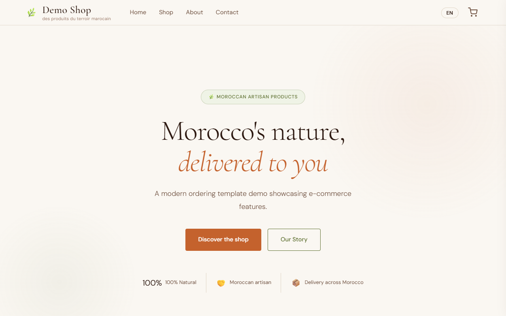
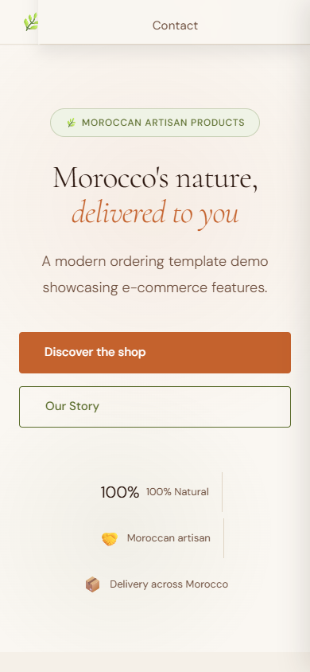
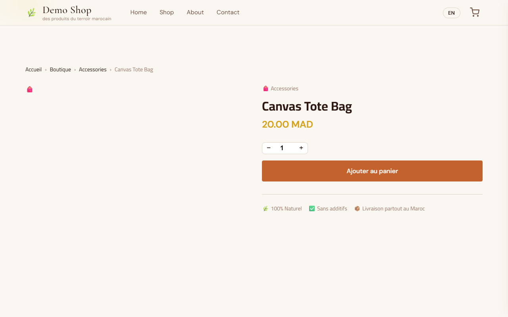
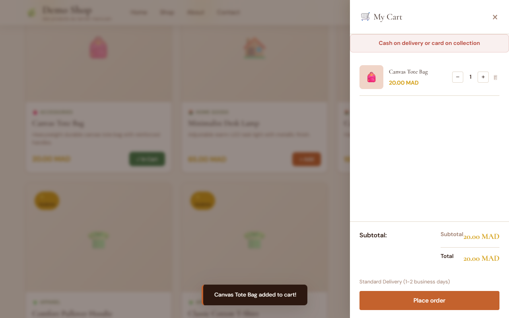
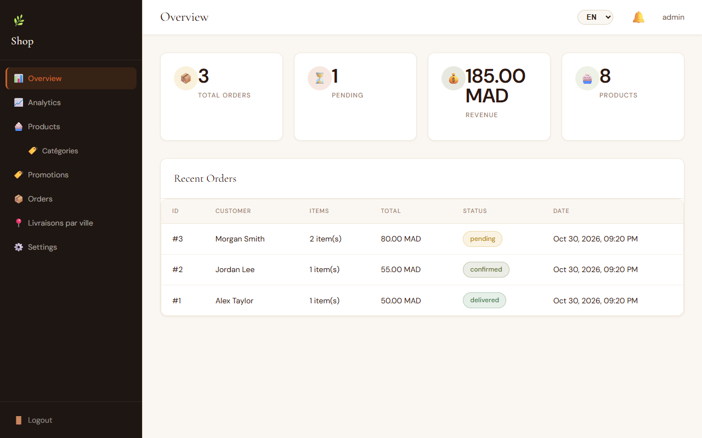
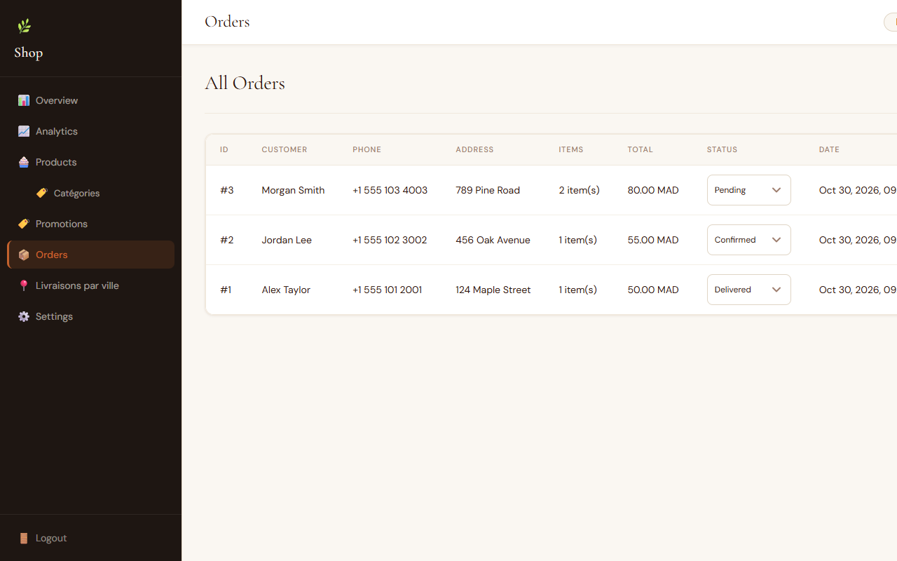

# Shop Ordering Platform

[](https://github.com/sabirkaddouri/business-ordering-platform/actions/workflows/ci.yml)

A full-stack ordering and e-commerce platform for small businesses, with an admin dashboard, multilingual support (French, English, Arabic with RTL), and WhatsApp order notifications.


## Features

- **Full product catalog** with categories, size variants, and stock management
- **Customer ordering system** with a Moroccan cities dropdown at checkout
- **Promo code system** with global and product-specific targeting
- **Admin panel** with an overview dashboard, product management, order management, and settings
- **City-based order sorting dashboard** for delivery logistics
- **Real-time admin notifications** for new orders
- **WhatsApp integration** for order confirmations and customer updates
- **Dynamic shop settings** connected live to the client-facing website
- **Analytics page** with revenue tracking and best-selling products
- **Store open/closed toggle** with a custom closed message
- **Multilingual Support** (French, English, Arabic with RTL layout)

## Tech Stack

- **Frontend:** HTML, CSS, Vanilla JavaScript
- **Backend:** Node.js, Express.js
- **Database:** PostgreSQL
- **Hosting:** Railway (planned)

## Getting Started

1. **Clone the repository:**
   ```bash
   git clone https://github.com/sabirkaddouri/business-ordering-platform.git
   ```

2. **Install dependencies:**
   ```bash
   npm install
   ```

3. **Copy the environment file:**
   ```bash
   cp .env.example .env
   ```

4. **Environment Variables:**
   Ensure your `.env` file contains the following variables:
   - `DATABASE_URL` (PostgreSQL connection string)
   - `JWT_SECRET` (Secret key for JWT authentication)
   - `ADMIN_USERNAME` (Default admin username)
   - `ADMIN_PASSWORD` (Default admin password)
   - `ALLOWED_ORIGINS` (Comma-separated list of allowed CORS origins)

5. **Start the development server:**
   ```bash
   npm run dev
   ```
   *or*
   ```bash
   npm start
   ```

6. **Open** `http://localhost:5000` in your browser.

## Project Structure

- `/public` — client-facing HTML, CSS, and JavaScript files
- `/admin` — admin panel HTML, CSS, and JavaScript files
- `/routes` — Express API route handlers
- `/db` — database connection and schema
- `/middleware` — Express middleware (authentication, validation)
- `server.js` — main entry point

## Screenshots

| Storefront (Desktop) | Storefront (Mobile) |
| :---: | :---: |
|  |  |

| Product Details | Cart Drawer |
| :---: | :---: |
|  |  |

| Admin Dashboard | Admin Orders |
| :---: | :---: |
|  |  |

## License

MIT License
