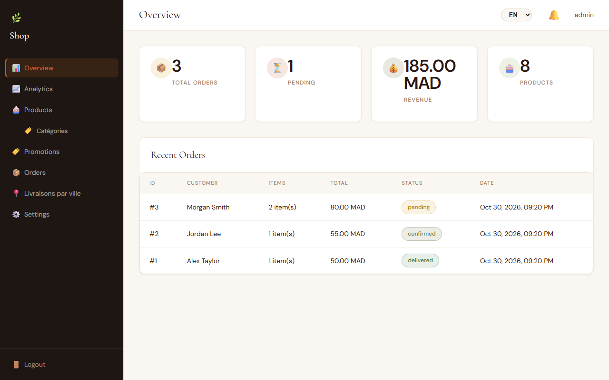
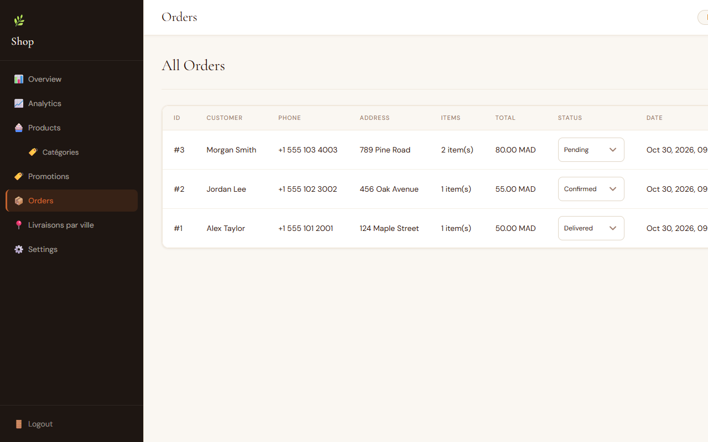

# Shop Ordering Platform

[](https://github.com/sabirkaddouri/business-ordering-platform/actions/workflows/ci.yml)

A full-stack ordering and e-commerce platform for small businesses, with an admin dashboard, multilingual support (French, English, Arabic with RTL), and WhatsApp order notifications.


## Features

- **Full product catalog** with categories, size variants, and stock management
- **Customer ordering system** with a Moroccan cities dropdown at checkout
- **Promo code system** with global and product-specific targeting
- **Admin panel** with an overview dashboard, product management, order management, and settings
- **City-based order sorting dashboard** for delivery logistics
- **Real-time admin notifications** for new orders
- **WhatsApp integration** for order confirmations and customer updates
- **Dynamic shop settings** connected live to the client-facing website
- **Analytics page** with revenue tracking and best-selling products
- **Store open/closed toggle** with a custom closed message
- **Multilingual Support** (French, English, Arabic with RTL layout)

## Tech Stack

- **Frontend:** HTML, CSS, Vanilla JavaScript
- **Backend:** Node.js, Express.js
- **Database:** PostgreSQL
- **Hosting:** Railway (planned)

## Getting Started

1. **Clone the repository:**
   ```bash
   git clone https://github.com/sabirkaddouri/business-ordering-platform.git
   ```

2. **Install dependencies:**
   ```bash
   npm install
   ```

3. **Copy the environment file:**
   ```bash
   cp .env.example .env
   ```

4. **Environment Variables:**
   Ensure your `.env` file contains the following variables:
   - `DATABASE_URL` (PostgreSQL connection string)
   - `JWT_SECRET` (Secret key for JWT authentication)
   - `ADMIN_USERNAME` (Default admin username)
   - `ADMIN_PASSWORD` (Default admin password)
   - `ALLOWED_ORIGINS` (Comma-separated list of allowed CORS origins)

5. **Start the development server:**
   ```bash
   npm run dev
   ```
   *or*
   ```bash
   npm start
   ```

6. **Open** `http://localhost:5000` in your browser.

## Project Structure

- `/public` — client-facing HTML, CSS, and JavaScript files
- `/admin` — admin panel HTML, CSS, and JavaScript files
- `/routes` — Express API route handlers
- `/db` — database connection and schema
- `/middleware` — Express middleware (authentication, validation)
- `server.js` — main entry point

## Screenshots

| Storefront (Desktop) | Storefront (Mobile) |
| :---: | :---: |
|  |  |

| Product Details | Cart Drawer |
| :---: | :---: |
|  |  |

| Admin Dashboard | Admin Orders |
| :---: | :---: |
|  |  |


## Security

This application includes the following security hardening measures:

### HTTP Security
- **Helmet** security headers with a tailored Content-Security-Policy
- **HSTS** enabled in production with preload
- **X-Powered-By** header disabled
- **HTTP-to-HTTPS** redirect in production

### Rate Limiting & Brute Force Protection
- Login lockout: max 5 failed attempts per 15 minutes (per IP and per username)
- OTP endpoint: max 5 requests per IP per 15 minutes
- Order endpoint: max 10 requests per IP per 15 minutes
- General API rate limiter: 300 requests per 15 minutes per IP

### Input Validation
- All POST/PUT/PATCH bodies validated with **Zod** schemas (`.strict()` — unknown fields rejected)
- Route parameters validated as positive integers
- JSON body size limit: 100KB
- All SQL queries use parameterized placeholders

### Authentication
- JWT tokens pinned to HS256 algorithm with 2-hour expiry
- bcrypt cost factor 12
- Timing-safe login (dummy hash comparison for non-existent users)
- Production startup checks: JWT_SECRET ≥ 32 chars, ADMIN_PASSWORD ≥ 12 chars and not a known weak value

### File Uploads
- Restricted to JPEG, PNG, and WebP only (no GIF)
- Magic-byte / file-header validation (prevents extension spoofing)
- 5MB file size limit

### XSS Prevention
- All dynamic user content escaped with `escapeHtml()` in both storefront and admin

### CORS
- Production requires explicit `ALLOWED_ORIGINS` whitelist — no wildcard fallback

### Error Handling
- Central error handler hides stack traces and internal details in production
- OTP codes are never logged; only last 4 digits of phone are logged
- API 404 handler returns clean JSON error

### Required Production Environment Variables

| Variable | Description |
| --- | --- |
| `DATABASE_URL` | PostgreSQL connection string |
| `JWT_SECRET` | ≥ 32 character secret for JWT signing |
| `ADMIN_USERNAME` | Admin login username |
| `ADMIN_PASSWORD` | ≥ 12 character admin password (not a common weak value) |
| `ALLOWED_ORIGINS` | Comma-separated list of allowed CORS origins |
| `NODE_ENV` | Must be set to `production` on the host server to enable all production security checks (HSTS, CSP, JWT length, password strength, CORS restrictions, error masking) |

> [!IMPORTANT]
> **Production Deployment Notes:**
> - `NODE_ENV=production` **must be set on the host server** (e.g., Railway, Render, VPS) to activate strict security checks and protections.
> - `ENFORCE_OTP` **must stay `false`** until a real SMS provider (such as Twilio) is connected; otherwise orders will be blocked in production since the built-in SMS agent is a development mock.

### Optional Environment Variables

| Variable | Description |
| --- | --- |
| `LOGIN_MAX_ATTEMPTS` | Maximum failed login attempts before lockout (default: 5) |
| `LOGIN_LOCKOUT_MINUTES` | Lockout duration in minutes after reaching max failed login attempts (default: 10) |
| `ENFORCE_OTP` | Must stay `false` until a real SMS provider is connected. Set to `true` only after configuring a live SMS provider |
| `CLOUDINARY_CLOUD_NAME` | Cloudinary cloud name for image uploads |
| `CLOUDINARY_API_KEY` | Cloudinary API key |
| `CLOUDINARY_API_SECRET` | Cloudinary API secret |

## License

MIT License
